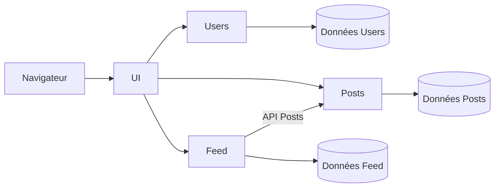

# Fil d'actualité

Projet de Cloud Computing, Polytech 2026-2027.

Application de type réseau social, découpée en microservices : un utilisateur crée un compte, publie des textes et des photos, suit d'autres utilisateurs et consulte leurs publications dans un fil.

> **État du projet :** cadrage. Ce dépôt contient l'architecture et l'organisation de l'équipe, pas encore de code.

## Première version

- Créer un compte, se connecter, se déconnecter et changer son mot de passe.
- Publier un texte, avec éventuellement une photo.
- Consulter les publications d'un utilisateur.
- Suivre et ne plus suivre un utilisateur.
- Afficher les publications des comptes suivis, de la plus récente à la plus ancienne.

Les commentaires, les likes et la messagerie sont hors périmètre tant que ce parcours n'est pas terminé.

## Architecture



| Composant | Responsabilité | Données propres |
| --- | --- | --- |
| UI | Afficher les pages et transmettre les actions aux microservices | Aucune donnée métier |
| Users | Gérer les comptes et l'authentification | Identifiants, profils, mots de passe hachés |
| Posts | Créer et consulter les publications | Textes, auteurs, dates, références des photos |
| Feed | Gérer les abonnements et construire le fil | Relations entre abonnés et comptes suivis |

Deux règles structurent le projet :

1. Le navigateur accède uniquement à UI.
2. Chaque microservice accède uniquement à ses propres données. Pour obtenir celles d'un autre service, il passe par son API.

## Stack prévue

| Besoin | En local | Sur AWS |
| --- | --- | --- |
| Services | Python, Flask | Conteneurs sur ECS |
| Démarrage | Docker Compose | Terraform |
| Données | SQLite, une base par service | DynamoDB |
| Photos | Stockage local | S3 |
| Fil | Appels HTTP entre services | Événements avec SQS ou EventBridge |

## Organisation du dépôt

```text
.
├── ui/          Application Flask, pages HTML et CSS
├── users/       API des comptes
├── posts/       API des publications
├── feed/        API des abonnements et du fil
├── infra/       Infrastructure Terraform (étape cloud)
└── docs/        Architecture et organisation
```

Les fichiers `docker-compose.yml` et `.env.example` seront ajoutés avec les premiers conteneurs.

## Documentation

- [Architecture détaillée](docs/architecture.md)
- [Organisation de l'équipe](docs/organisation.md)

## Équipe

| Membre | Responsabilité principale |
| --- | --- |
| Abdallah Alex | UI, Users, sécurité |
| Falcao Felipe | Posts, photos |
| Caramella Enzo | Feed, conteneurs, infrastructure |
