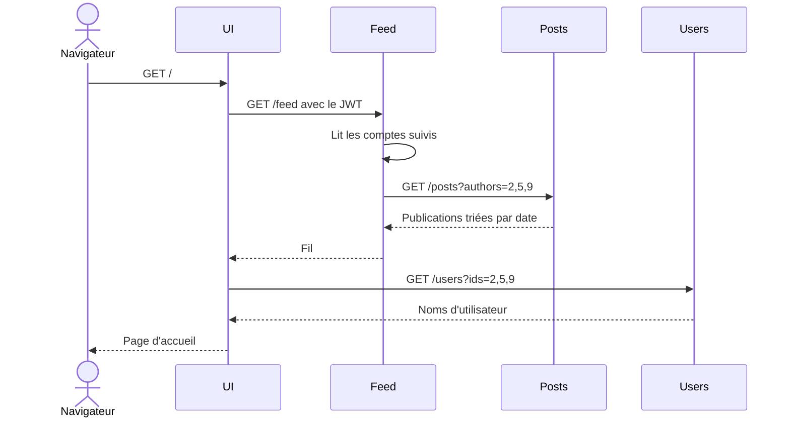
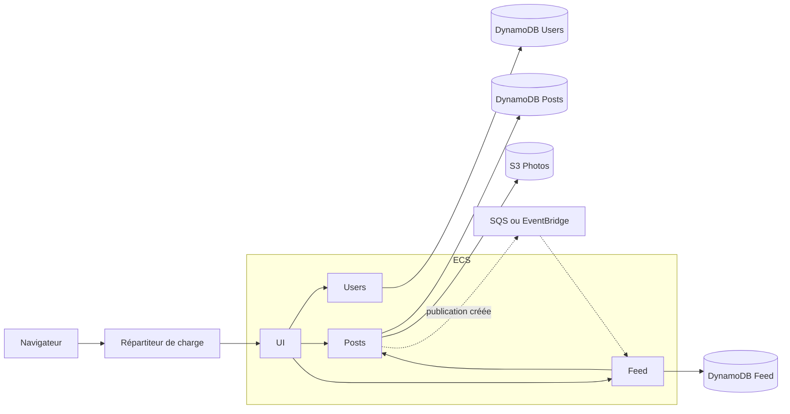

# Architecture

Ce document décrit l'architecture visée. Il reste une proposition de départ : les API et les modèles peuvent évoluer, à condition de mettre ce document à jour dans la même pull request.

## Principes

- **UI est le seul point d'entrée.** Le navigateur ne contacte jamais directement Users, Posts ou Feed.
- **Chaque service possède ses données.** Aucun service ne lit la base d'un autre.
- **Les identifiants circulent, pas les jointures.** `author_id` ou `followed_id` sont de simples valeurs, sans clé étrangère entre services.
- **Le stockage est isolé.** Dans chaque service, un fichier dédié regroupe les accès aux données pour faciliter le passage de SQLite à DynamoDB.
- **Aucun secret dans Git.** La configuration passe par des variables d'environnement.

## Version locale

Tous les services tournent dans des conteneurs lancés par Docker Compose et communiquent sur le réseau interne. Seul le port de UI est exposé sur la machine.

Le fil est calculé à chaque consultation :



## Authentification

1. UI transmet l'identifiant et le mot de passe à Users.
2. Users vérifie le mot de passe haché et renvoie un JWT signé.
3. UI conserve le JWT dans un cookie `HttpOnly`.
4. UI ajoute le JWT dans l'en-tête `Authorization` de ses appels aux services.
5. Chaque service vérifie la signature et lit l'identifiant de l'utilisateur dans le jeton.

La déconnexion supprime le cookie. Le jeton a une durée de vie courte, car il n'est pas révoqué côté serveur.

## Contrats d'API

Ces contrats permettent de travailler en parallèle. Sauf mention contraire, les routes demandent un JWT valide.

### Users

| Méthode | Route | Rôle |
| --- | --- | --- |
| `POST` | `/register` | Créer un compte (public) |
| `POST` | `/login` | Se connecter et obtenir un JWT (public) |
| `PUT` | `/me/password` | Changer son mot de passe |
| `GET` | `/users/{id}` | Consulter un profil |
| `GET` | `/users?ids=1,2` | Récupérer plusieurs profils |
| `GET` | `/users?search=nom` | Rechercher un utilisateur |

### Posts

| Méthode | Route | Rôle |
| --- | --- | --- |
| `POST` | `/posts` | Créer une publication, avec une photo facultative |
| `GET` | `/posts/{id}/image` | Récupérer la photo d'une publication |
| `GET` | `/posts?authors=1,2&limit=50` | Lister les publications d'un ou plusieurs auteurs, de la plus récente à la plus ancienne |

### Feed

| Méthode | Route | Rôle |
| --- | --- | --- |
| `PUT` | `/follows/{user_id}` | Suivre un utilisateur |
| `DELETE` | `/follows/{user_id}` | Ne plus suivre un utilisateur |
| `GET` | `/follows` | Lister ses abonnements |
| `GET` | `/feed` | Obtenir son fil |

Tous les services exposent aussi `GET /health`, sans authentification, pour les vérifications de santé.

## Modèle de données

```text
Users.users     id, username, email, password_hash, created_at
Posts.posts     id, author_id, content, image_key, created_at
Feed.follows    follower_id, followed_id, created_at
```

Pour DynamoDB, les tables seront conçues à partir de ces accès :

| Service | Accès principal | Remarque |
| --- | --- | --- |
| Users | Par `id` et par `username` | Index secondaire pour la connexion |
| Posts | Par `author_id`, trié par `created_at` | Clé de partition et clé de tri |
| Feed | Par `follower_id` | Clé composée avec `followed_id` |

## Version AWS

Le passage au cloud commence lorsque le parcours local fonctionne de bout en bout. L'ordre suit les paliers du cours : données dans les services AWS, déploiement sur ECS avec Terraform, puis sécurisation.



Le répartiteur de charge et le schéma final sont à confirmer selon les consignes du cours.

## Évolution du fil

| Étape | Fonctionnement | Intérêt |
| --- | --- | --- |
| Première version | Feed appelle Posts à chaque consultation | Simple à réaliser et à tester |
| Version événementielle | Posts publie un événement, Feed prépare les fils à l'avance | Réduit le couplage et les appels à la lecture |

## Risques identifiés

| Risque | Réponse prévue |
| --- | --- |
| Une API change sans prévenir | Tout changement de contrat passe par une pull request relue par le service concerné |
| Feed dépend de Posts | Feed renvoie une erreur claire si Posts ne répond pas, et un délai d'expiration limite l'attente |
| Le fil devient lent avec beaucoup d'abonnements | Limitation avec `limit`, puis version événementielle |
| Un secret est publié | `.env` ignoré par Git, seul `.env.example` est versionné |
