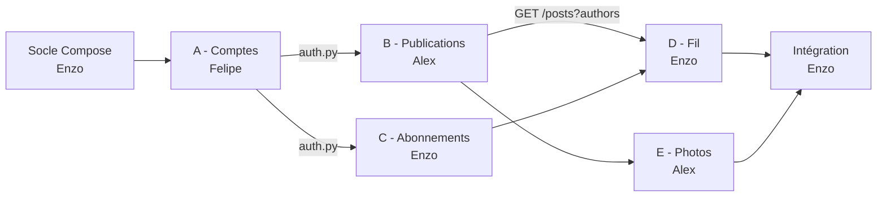

# Répartition des tâches

Le projet est découpé en trois parties, une par membre. Chaque partie couvre la version locale puis le passage au cloud. Les étapes A à E et les paliers cloud sont décrits dans [organisation.md](organisation.md), les contrats d'API dans [architecture.md](architecture.md).

| Partie | Membre | Périmètre | Dossiers |
| --- | --- | --- | --- |
| 1 | Falcao Felipe | UI, Users, sécurité | `ui/`, `users/` |
| 2 | Abdallah Alex | Posts, photos | `posts/` |
| 3 | Caramella Enzo | Feed, conteneurs, infrastructure, intégration des trois parties | `feed/`, `infra/`, `docker-compose.yml`, `.env.example` |

## Conventions communes

Ces règles sont fixées par la partie 3 dès la première séance, pour que les trois parties s'assemblent sans retouche.

| Sujet | Convention |
| --- | --- |
| Port interne | Chaque service écoute sur le port `5000` dans son conteneur. Seul UI est exposé, sur `localhost:8000`. |
| Adresses internes | `http://users:5000`, `http://posts:5000`, `http://feed:5000`, lues dans `USERS_URL`, `POSTS_URL` et `FEED_URL`. |
| JWT | HS256, secret dans `JWT_SECRET`, champ `sub` contenant l'identifiant de l'utilisateur, champ `username`, expiration d'une heure. |
| Vérification du jeton | Un module `auth.py` identique dans chaque service, fourni par la partie 1. |
| Erreurs | Réponse JSON `{"error": "message"}` avec le code HTTP adapté (`400`, `401`, `403`, `404`, `409`, `503`). |
| Stockage | Tous les accès aux données passent par `storage.py` dans chaque service. |
| Structure d'un service | `app.py`, `storage.py`, `auth.py`, `requirements.txt`, `Dockerfile`. |
| Santé | `GET /health` renvoie `{"status": "ok"}` sans authentification. |

## Partie 1 : Felipe (UI, Users, sécurité)

### Users

- [ ] Créer l'application Flask, son `Dockerfile` et `storage.py` avec la table `users` (SQLite).
- [ ] `POST /register` : vérifier les champs, refuser un nom ou un email déjà pris (`409`), hacher le mot de passe.
- [ ] `POST /login` : vérifier le mot de passe et renvoyer un JWT signé.
- [ ] `PUT /me/password` : exiger l'ancien mot de passe avant de le changer.
- [ ] `GET /users/{id}`, `GET /users?ids=1,2`, `GET /users?search=nom`, sans jamais renvoyer `password_hash`.
- [ ] Écrire `auth.py` (décorateur qui vérifie le JWT et expose l'identifiant de l'utilisateur) et le transmettre à Alex et Enzo **dès l'étape A**.

### UI

- [ ] Créer l'application Flask, les gabarits Jinja et le CSS.
- [ ] Pages : inscription, connexion, déconnexion, changement de mot de passe.
- [ ] Conserver le JWT dans un cookie `HttpOnly` et `SameSite=Lax`, puis l'ajouter dans l'en-tête `Authorization` des appels aux services.
- [ ] Page d'accueil affichant le fil (Feed), avec les noms d'auteurs récupérés auprès de Users.
- [ ] Page de profil : publications de l'utilisateur et bouton suivre ou ne plus suivre.
- [ ] Formulaire de publication (texte et photo facultative) transmis à Posts.
- [ ] Recherche d'utilisateurs et liste de ses abonnements.
- [ ] Route qui relaie les photos depuis Posts, puisque le navigateur ne parle qu'à UI.
- [ ] Délai d'expiration sur chaque appel et message clair si un service ne répond pas.

### Sécurité

- [ ] Protéger les formulaires contre le CSRF.
- [ ] Lire tous les secrets dans les variables d'environnement, rien en dur.
- [ ] Palier cloud : secret JWT dans Secrets Manager ou SSM, rôle IAM minimal par service, groupes de sécurité qui n'exposent que UI derrière le répartiteur de charge.

**Résultat à vérifier :** je m'inscris, je me connecte, je change mon mot de passe et je me déconnecte, uniquement via `localhost:8000`.

## Partie 2 : Alex (Posts, photos)

### Publications

- [ ] Créer l'application Flask, son `Dockerfile` et `storage.py` avec la table `posts` (SQLite).
- [ ] Intégrer `auth.py` fourni par Felipe. En attendant, générer un jeton de test avec le même `JWT_SECRET`.
- [ ] `POST /posts` : l'auteur vient du jeton, jamais du corps de la requête. Vérifier la longueur du texte.
- [ ] `GET /posts?authors=1,2&limit=50` : publications triées de la plus récente à la plus ancienne, `limit` plafonné.
- [ ] Indiquer dans chaque publication si elle a une photo, pour que UI sache l'afficher.
- [ ] Prévenir Enzo dès que `GET /posts?authors=` est utilisable, car l'étape D en dépend.

### Photos

- [ ] Accepter une image facultative en `multipart/form-data` dans `POST /posts`.
- [ ] Limiter les formats (JPEG, PNG, WebP) et la taille (par exemple 5 Mo), renommer le fichier avec un UUID.
- [ ] Isoler le stockage des photos dans `images.py` : dossier local monté en volume, puis S3.
- [ ] `GET /posts/{id}/image` : renvoyer la photo avec le bon type MIME.

### Palier cloud : données

- [ ] Adapter `storage.py` de Posts à DynamoDB : clé de partition `author_id`, clé de tri `created_at`.
- [ ] Passer `images.py` sur un bucket S3 privé avec `boto3`.
- [ ] Préparer un exemple d'accès DynamoDB et aider Felipe et Enzo à adapter leur propre `storage.py`.
- [ ] Optionnel : publier un événement « publication créée » vers SQS ou EventBridge, avec Enzo.

**Résultat à vérifier :** je publie un texte avec une photo et je le retrouve sur mon profil, photo comprise.

## Partie 3 : Enzo (Feed, conteneurs, infrastructure, intégration)

### Socle commun (première séance)

- [ ] Écrire `docker-compose.yml` avec les quatre services, un volume par base SQLite et un volume pour les photos.
- [ ] Écrire `.env.example` (`JWT_SECRET`, `USERS_URL`, `POSTS_URL`, `FEED_URL`) sans véritable secret.
- [ ] Fournir un squelette de service (`Dockerfile`, `requirements.txt`, `app.py` avec `/health`) que chacun reprend.
- [ ] Documenter dans le README comment lancer le projet.

### Feed

- [ ] Créer l'application Flask et `storage.py` avec la table `follows` (clé composée `follower_id`, `followed_id`).
- [ ] `PUT /follows/{user_id}` : idempotent, refuser de se suivre soi-même.
- [ ] `DELETE /follows/{user_id}` et `GET /follows`.
- [ ] `GET /feed` : lire les comptes suivis, appeler `GET /posts?authors=...` en transmettant le JWT, renvoyer le fil trié.
- [ ] Délai d'expiration vers Posts et réponse `503` claire si Posts ne répond pas.

### Intégration

- [ ] Relire et fusionner les pull requests, en vérifiant qu'elles respectent les contrats d'[architecture.md](architecture.md).
- [ ] Écrire un test de bout en bout : deux comptes, une publication, un abonnement, puis le fil.
- [ ] Vérifier après chaque fusion que `docker compose up` démarre tout et que le parcours complet fonctionne.
- [ ] Optionnel : GitHub Actions qui construit les images à chaque pull request.

### Palier cloud : déploiement

- [ ] Adapter `storage.py` de Feed à DynamoDB : clé de partition `follower_id`, clé de tri `followed_id`.
- [ ] Terraform dans `infra/` : dépôts ECR, cluster ECS Fargate, une définition de tâche et un service par composant.
- [ ] Répartiteur de charge vers UI uniquement, découverte de services (Cloud Map) pour les appels internes.
- [ ] Tables DynamoDB, bucket S3 et journaux CloudWatch, avec Alex pour les données et Felipe pour les droits IAM.
- [ ] Optionnel : Feed consomme les événements de Posts et prépare les fils à l'avance.

**Résultat à vérifier :** je suis un autre utilisateur et mon accueil affiche ses publications dans l'ordre, en local puis sur AWS.

## Dépendances entre les parties

Alex et Enzo peuvent commencer Posts et Feed sans attendre la fin de l'étape A, grâce aux contrats d'API et à un jeton de test signé avec le même `JWT_SECRET`. Felipe ajoute les pages UI au fur et à mesure que les API sont disponibles.
